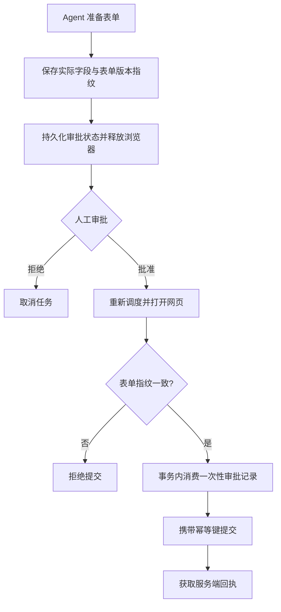
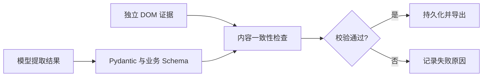
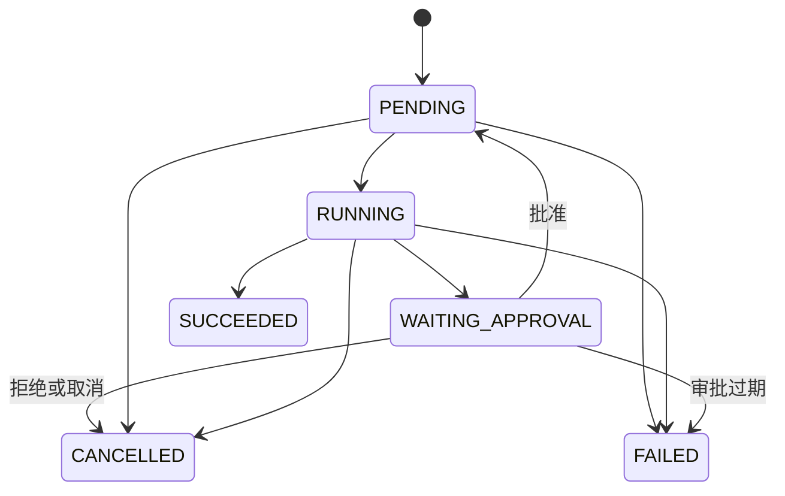
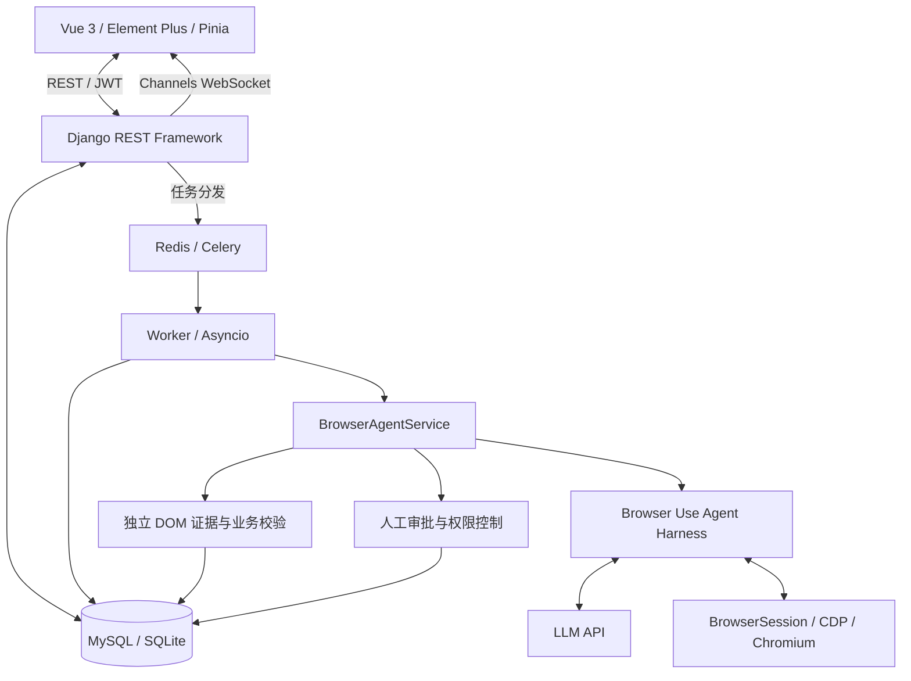

# BrowserFlow Agent

> 面向复杂 Web 任务的自主浏览器智能体执行与管理平台

    

BrowserFlow Agent 基于 [Browser Use](https://github.com/browser-use/browser-use) 构建，将大模型的环境感知、决策与工具调用能力同异步任务调度、人工审批、结果校验和实时监控相结合，实现从自然语言任务到可验证执行结果的完整链路。

项目聚焦长程 Agent 执行中的四类工程问题：**执行不可控、结果不可靠、任务易中断、过程难观测**。

[核心设计](#核心设计) · [系统架构](#系统架构) · [运行演示](#运行演示) · [测试与评测](#测试与评测) · [快速启动](#快速启动)

## 核心设计

| 工程难题 | 解决方案 |
| --- | --- |
| 高风险操作缺少约束，审批后内容变化或重复提交 | Human-in-the-Loop、持久化审批状态、表单指纹、一次性审批与幂等键 |
| 模型输出格式正确，但内容与真实网页不一致 | Pydantic、业务 Schema、独立 DOM 证据多级校验 |
| 长程任务阻塞请求，取消、超时与 Worker 异常难处理 | Celery + Redis、Asyncio 执行监控、任务状态机与过期任务回收 |
| 执行过程难以追踪，工具及网络访问权限难约束 | WebSocket、执行轨迹与截图、工具白名单、出网代理与用户权限校验 |

### 01 · Agent Harness 与动态工具调用

复用 Browser Use 的自主执行循环、浏览器状态感知、上下文管理、模型适配和动态工具注册机制，在平台层通过 `BrowserAgentService` 接入浏览器会话及业务工具。

- 通过 CDP 接入 Chromium，形成环境感知—模型决策—工具执行—结果反馈的迭代闭环。
- 基于装饰器注册数据采集、结构化结果保存、证据校验、截图和人工审批等业务工具。
- 限制可用工具集合、单步动作数量及任务最大步数，约束自主执行范围。
- 支持 OpenAI Chat Completions 兼容模型，记录执行步骤、错误、截图与可获取的模型用量。

源码：[Agent 适配层](backend/apps/core/agent.py) · [上游 Agent 主循环](vendor/browser-use/browser_use/agent/service.py)

### 02 · Human-in-the-Loop 与幂等执行

针对表单提交等具有外部副作用的操作，采用人工审批与确定性提交相结合的机制。



审批通过后重新校验实际表单，而不是直接重放模型动作；提交前消费一次性审批记录，避免结果不明确时盲目重试。内置示例服务端使用幂等键避免重复产生业务记录。

当前表单写入仅开放给隔离的企业表单 Demo，其他网站需要单独实现并授权相应审批适配器。

源码：[审批服务](backend/apps/core/services.py) · [提交逻辑](backend/apps/core/agent.py) · [Worker](backend/apps/core/worker.py)

### 03 · 结构化输出与独立证据校验

将模型输出作为待验证结果，而不是直接视为事实。



针对内置商品目录执行行级数据匹配、数量及来源检查；其他已采集网页证据主要采用字段级文本、链接匹配作为辅助核验。该机制能够检测部分格式合法但内容错误的结果，不等同于消除模型幻觉或验证外部网页真实性。

源码：[结果验证逻辑](backend/apps/core/agent.py) · [结果导出](backend/apps/core/exports.py)

### 04 · 异步任务调度与可靠性

将任务定义（Task）与单次运行（TaskRun）分离，每次执行独立记录状态、步骤、日志、审批与结果。

- Celery + Redis 将 API 请求与长时间运行的浏览器任务解耦。
- Asyncio 并发运行 Agent 与取消监控协程，统一处理取消、执行超时及资源清理。
- 数据库事务、行锁与事务提交后分发机制控制状态流转和重复任务领取；行锁效果依赖数据库类型，MySQL 与本地 SQLite 的并发行为不同。
- 周期性回收过期执行记录，避免异常任务长期停留在运行中；过期任务标记为失败，而不是自动重放有副作用的操作。



源码：[状态模型](backend/apps/core/models.py) · [任务服务](backend/apps/core/services.py) · [异步 Worker](backend/apps/core/worker.py)

### 05 · 执行安全与可观测性

- Django Channels + WebSocket 推送任务状态与执行步骤，展示截图、日志和校验结果，断线后重新获取持久化状态。
- JWT 认证与任务归属校验限制跨用户访问任务、审批及导出结果。
- 工具白名单、域名白名单、URL 校验及 GuardProxy 出网检查约束浏览器访问范围。
- 敏感字段脱敏、执行步数限制、超时控制及审批提交边界。

源码：[实时事件](backend/apps/core/consumer.py) · [网络代理](backend/apps/core/network.py) · [安全校验](backend/apps/core/security.py)

## 系统架构



| 层级 | 技术栈 |
| --- | --- |
| Agent 引擎 | Browser Use 0.13.14、Pydantic、LLM API、CDP |
| 浏览器执行 | Chromium、Playwright、GuardProxy |
| API 与实时通信 | Django REST Framework、JWT、Django Channels、WebSocket |
| 异步任务 | Celery、Redis、Asyncio；本地独立轮询 Worker |
| 数据持久化 | MySQL（容器部署）、SQLite（本地演示） |
| 前端 | Vue 3、TypeScript、Vite、Pinia、Element Plus、ECharts |
| 部署 | Docker Compose、Daphne、Nginx、uv |

## 运行演示

项目提供完整 Web 工作台和隔离测试站点，无需依赖第三方网页即可演示浏览器任务执行。

| 场景 | 展示内容 |
| --- | --- |
| 公开信息采集 | 网页访问、数据提取、独立证据校验、CSV / JSON 导出 |
| 动态目录 | 页面筛选、动态列表及分页采集 |
| 企业表单申请 | 表单准备、审批暂停、批准或拒绝、受控提交与回执 |
| 任务管理 | 历史任务、执行记录、步骤截图、取消与结果查看 |

默认采用确定性 Mock 执行路径与真实 Chromium，无需模型密钥即可体验。配置兼容模型后可使用 Browser Use 自主执行模式。当前平台限制视觉输入、独立规划和高风险工具，不代表无约束的通用网页自动化能力。

## 测试与评测

| 测试模块 | 覆盖内容 |
| --- | --- |
| [API 测试](backend/tests/test_api.py) | 认证、任务隔离、重复投递、审批及状态流转、过期任务回收 |
| [浏览器测试](backend/tests/test_browser.py) | 真实 Chromium、脚本化模型、采集、动态网页、分页、审批、取消、超时 |
| [安全测试](backend/tests/test_security.py) | 危险地址、DNS Rebinding、Schema 校验及敏感字段脱敏 |
| [WebSocket 测试](backend/tests/test_websocket.py) | 认证、任务归属与事件推送 |
| 前端端到端测试 | 登录、任务创建、执行进度、结果导出与审批 |

### 专项评测计划

| 评测方向 | 对照或场景 | 核心指标 |
| --- | --- | --- |
| 结果可靠性 | 仅 Schema 与加入 DOM 证据校验 | 错误检出率、误拒率、校验开销 |
| 人工审批与幂等性 | 正常审批、拒绝、篡改、重复审批及异常提交 | 未授权提交数、重复提交数、正常提交成功率 |
| 调度可靠性 | 并发提交、取消、超时、Worker 异常退出 | API P95 延迟、取消响应时间、异常回收率 |
| Agent 端到端能力 | 固定任务集、真实 LLM、独立结果判定 | 任务成功率、执行步数、Token 消耗与耗时 |

专项评测数值将在实际运行并保存可复现记录后公布。Mock 演示不作为真实模型任务成功率。

### 运行测试

```powershell
Push-Location backend
..\.venv\Scripts\python.exe manage.py check
..\.venv\Scripts\python.exe -m pytest -q
Pop-Location
npm --prefix frontend run build
npm --prefix frontend run test:e2e
```

## 快速启动

### 本地运行（Windows）

环境要求：Python 3.12、uv、Node.js 20.19+、npm。首次启动需要安装 Chromium。

从仓库根目录执行：

```powershell
$env:UV_PROJECT_ENVIRONMENT = Join-Path $PWD '.venv'
uv sync --project backend --python 3.12 --extra agent --frozen
.\.venv\Scripts\python.exe -m playwright install chromium
npm --prefix frontend ci
.\.venv\Scripts\python.exe scripts\dev.py
```

打开 <http://localhost:5173>，注册后进入 **任务模板**：

1. 运行「公开信息采集」，查看步骤、截图、校验结果和 CSV 导出。
2. 运行「企业表单申请」，在审批中心批准或拒绝，查看最终状态及回执。
3. 使用 Ctrl+C 关闭服务。

本地使用 SQLite 与独立轮询 Worker。前端、API 和测试站点分别使用端口 5173、8000、8090。

如果 Chromium 下载失败且本机已安装 Chrome，可设置 `$env:BROWSERFLOW_CHROMIUM_CHANNEL = 'chrome'` 后启动；本地浏览器测试同样读取该设置。

### 配置真实模型

在根目录 `.env` 中配置并重启服务，在创建任务时选择相应模型：

```dotenv
MODEL_PROVIDER=openai-compatible
MODEL_NAME=your-model-name
MODEL_BASE_URL=https://your-provider.example/v1
MODEL_API_KEY=
```

模型服务需要支持结构化输出。API Key 仅在服务端配置，请勿提交真实密钥。

### Docker Compose 部署

需要正在运行的 Linux 容器引擎。复制 `.env.example`，填写随机 `SECRET_KEY`，修改 MySQL 密码并同步 `DATABASE_URL`。

```powershell
Copy-Item .env.example .env
# 编辑配置后执行
docker compose config --quiet
docker compose up --build -d
```

访问 <http://localhost:8080>。初始化服务负责数据库迁移及示例模板写入。

- 管理后台：`/admin/`
- REST API：`/api/v1/`
- 实时通道：`/ws/tasks/{task_id}/`

使用 `docker compose exec web python manage.py createsuperuser` 创建管理账号。

## 项目结构

```text
browserflow-core-platform/
├── backend/
│   ├── apps/core/
│   │   ├── agent.py        # Agent 适配、业务工具、结果校验
│   │   ├── worker.py       # 异步任务执行与异常回收
│   │   ├── services.py     # 状态流转、任务分发、人工审批
│   │   ├── models.py       # 任务、运行记录、审批与结果
│   │   ├── consumer.py     # WebSocket 实时事件
│   │   ├── network.py      # 浏览器出网代理
│   │   └── security.py     # URL 校验与数据安全
│   └── tests/              # 后端自动化测试
├── frontend/               # Vue 3 工作台及端到端测试
├── demo-sites/             # 隔离的网页执行场景
├── vendor/browser-use/     # Browser Use 官方源码
├── docker/                 # 容器部署配置
├── scripts/dev.py          # 本地启动入口
└── docker-compose.yml
```

## 开源来源与许可证

浏览器智能体基础能力来自 [Browser Use](https://github.com/browser-use/browser-use)。平台侧的异步调度、任务管理、人工审批、结果验证、安全控制与可视化工作台位于 `backend/` 与 `frontend/`。

仓库内置 Browser Use 0.13.14 官方源码，本地与 Docker 均从该源码安装。上游发行包地址与 SHA256 记录在 [PROVENANCE.json](vendor/browser-use/PROVENANCE.json)。

本项目采用 [MIT License](LICENSE)，并保留 [Browser Use 上游许可证与版权声明](vendor/browser-use/LICENSE)。
