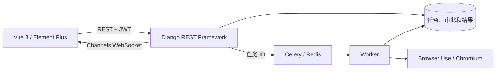

# BrowserFlow Agent

基于 [Browser Use](https://github.com/browser-use/browser-use) 的网页自动化工作台。用户可以创建采集或表单任务，实时查看浏览器执行步骤、截图和结果，并在提交表单前审核实际操作。

## 快速体验

需要 Python 3.12、uv、Node.js 20.19+ 和 npm。首次启动时会下载 Chromium。以下命令从项目根目录执行。

```powershell
$env:UV_PROJECT_ENVIRONMENT = Join-Path $PWD '.venv'
uv sync --project backend --python 3.12 --extra agent --frozen
.\.venv\Scripts\python.exe -m playwright install chromium
npm --prefix frontend ci
.\.venv\Scripts\python.exe scripts\dev.py
```

打开 <http://localhost:5173>，注册后进入 **任务模板**。

1. 选择 **公开信息采集** 并运行。查看浏览器步骤、截图、校验结果和 CSV 导出。
2. 选择 **企业表单申请** 并运行。任务会暂停，进入 **审批中心** 批准之后，工作台会显示提交结果和回执。
3. 使用 Ctrl+C 关闭本地服务。

本地演示使用 SQLite、独立轮询 Worker 和真实 Chromium。默认的 Mock 模型按固定步骤操作隔离的测试网页，适合无需密钥的演示。前端、API 和测试站点分别使用端口 5173、8000 和 8090。

如果 Chromium 下载失败且本机已安装 Chrome，可以设置 $env:BROWSERFLOW_CHROMIUM_CHANNEL = 'chrome' 后启动。本地浏览器测试也会读取此设置。

## 平台机制

- **任务与执行记录分离**。每次运行都有独立的步骤、日志和结果，支持取消、超时、受控重跑及异常租约回收。
- **实时执行视图**。Django Channels 推送任务状态和步骤。WebSocket 校验登录和任务归属，断线后可重新获取已保存的进度。
- **人工审批**。暂停时释放浏览器。恢复时重新打开网页并核对表单版本和字段摘要。批准后的提交使用一次性审批记录和幂等键。
- **结果校验与导出**。结构化结果经过 Pydantic、业务 Schema 和网页证据检查，可导出 CSV 或 JSON。
- **浏览器执行边界**。域名白名单和出网代理检查请求目标，日志对敏感字段脱敏。审批提交仅开放给内置企业表单示例。

## 架构



| 目录 | 职责 |
| --- | --- |
| `backend/apps/core/` | 任务 API、状态机、Worker、浏览器适配、审批、结果校验 |
| `backend/tests/` | API、权限、网络限制、WebSocket 和浏览器测试 |
| `frontend/` | Vue 3、TypeScript、Pinia、Element Plus、ECharts 工作台及端到端测试 |
| `demo-sites/` | 本地产品目录、动态列表和企业表单 |
| `docker/`、`docker-compose.yml` | MySQL、Redis、Celery、Daphne 和 Nginx 部署 |
| `scripts/dev.py` | 无 Docker 的本地启动入口 |

## 配置真实模型

在根目录的 `.env` 中加入下面的配置并重启服务。在创建任务时选择相应模型。

```dotenv
MODEL_PROVIDER=openai-compatible
MODEL_NAME=your-model-name
MODEL_BASE_URL=https://your-provider.example/v1
MODEL_API_KEY=
```

支持 OpenAI Chat Completions 兼容接口。模型服务需要支持结构化输出。账号与任务数据通过 JWT 和归属校验隔离。

## Docker Compose

使用正在运行的 Linux 容器引擎。将 `.env.example` 复制为 `.env`，填写随机 `SECRET_KEY`，修改 MySQL 密码并同步 `DATABASE_URL`。

```powershell
Copy-Item .env.example .env
# 编辑上面的配置后执行
docker compose config --quiet
docker compose up --build -d
```

打开 <http://localhost:8080>。初始化服务会运行数据库迁移并写入示例模板。管理后台为 `/admin/`，任务 API 为 `/api/v1/`，实时通道为 `/ws/tasks/{task_id}/`。可用 `docker compose exec web python manage.py createsuperuser` 创建管理账号。

## 验证

```powershell
Push-Location backend
..\.venv\Scripts\python.exe manage.py check
..\.venv\Scripts\python.exe -m pytest -q
Pop-Location
npm --prefix frontend run build
npm --prefix frontend run test:e2e
```

后端测试包含真实 Chromium 和脚本化 Browser Use 模型，用于覆盖采集、动态网页交互、审批、超时和取消。页面测试覆盖登录、任务创建、进度、结果导出和审批提交。

## 许可证

项目采用 [MIT](LICENSE)。Browser Use 作为固定版本的 Python 依赖接入，保留 [上游许可与版权声明](docs/BROWSER_USE_LICENSE)。
